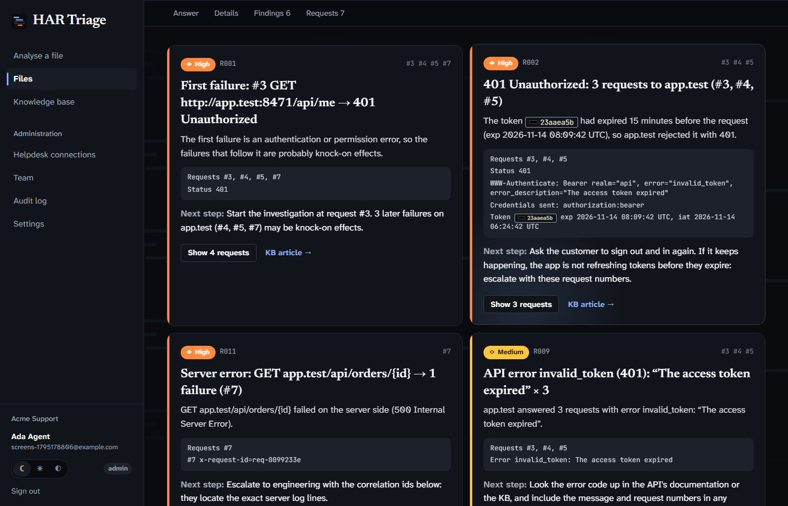
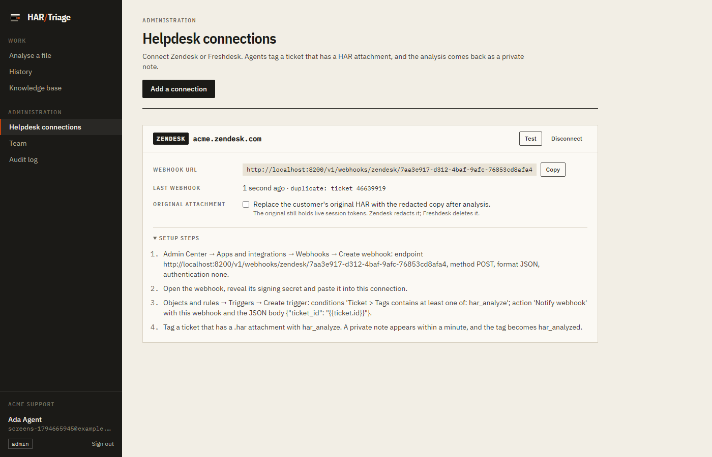
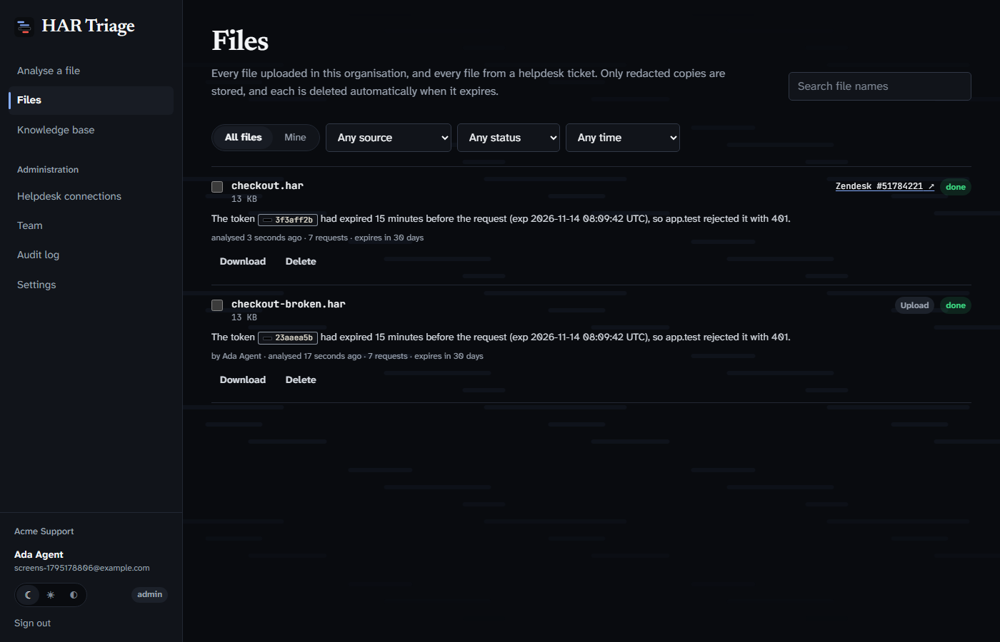
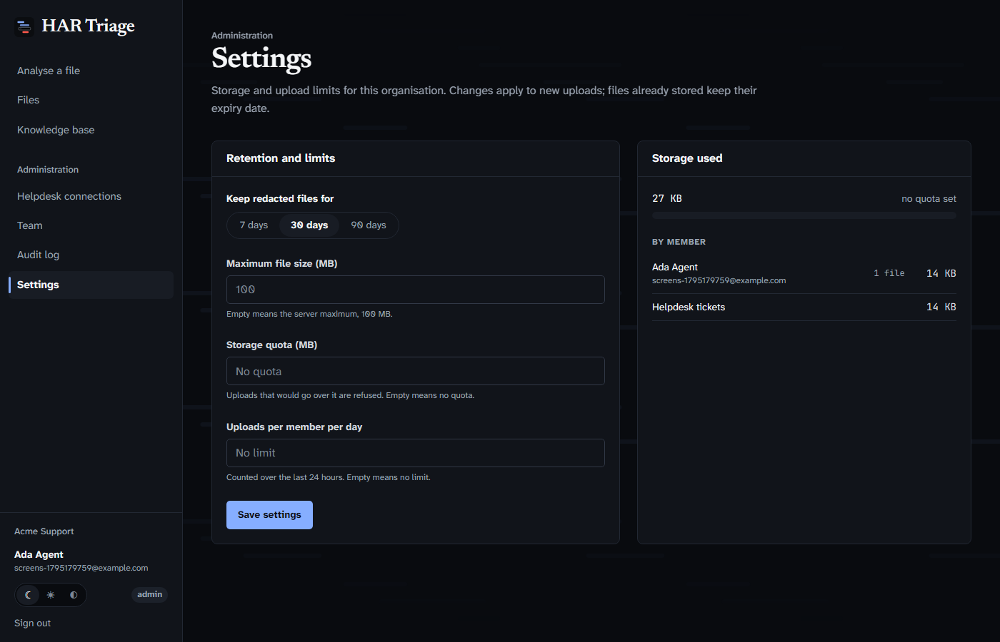
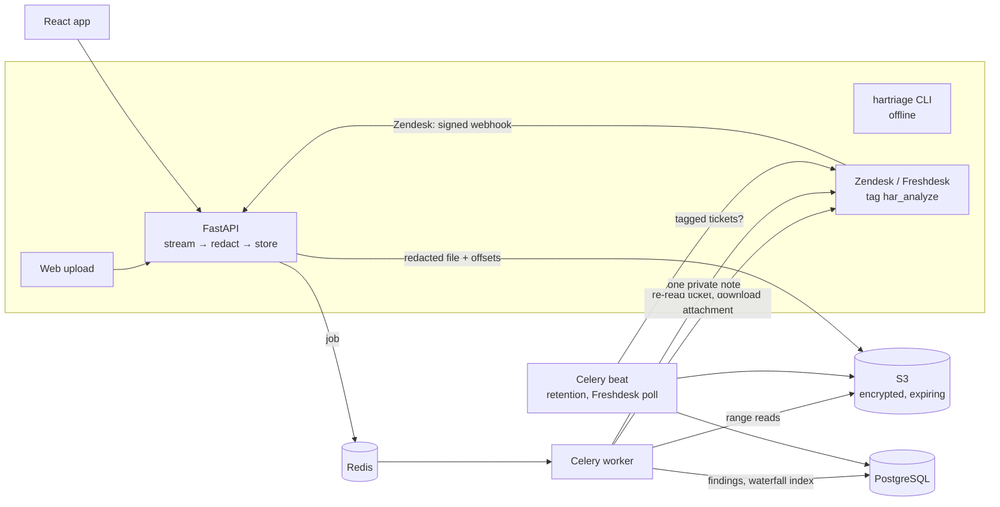

#  HAR Triage

**Removes the session tokens from a customer's HAR file before it is stored, then finds the failing request and writes the answer for the support ticket.**

**Live demo:** [hartriage.onrender.com](https://hartriage.onrender.com)

[](https://github.com/priyadharshanexe/hartriage/actions/workflows/ci.yml)
[](LICENSE)


Use it as a CLI, in the web app, or from Zendesk and Freshdesk: tag a ticket and the analysis comes back as a private note.

**Contents:** [Why this exists](#why-this-exists) · [Watch the demo](#watch-the-demo) · [What it looks like](#what-it-looks-like) · [Features](#features) · [How it works](#how-it-works) · [Architecture](#architecture) · [The rules](#the-rules) · [Security and redaction](#security-and-redaction) · [Quick start](#quick-start) · [Tested against real helpdesks](#tested-against-real-helpdesks) · [Tests and CI](#tests-and-ci) · [Performance](#performance) · [Decision records](#decision-records) · [Casebook](#casebook) · [Project layout](#project-layout)

## Why this exists

When a customer reports "the page is broken", support asks for a HAR file: the browser's record of every request, including its cookies and bearer tokens. In October 2023 an attacker inside Okta's support system took session tokens from customers' HAR files and used them to hijack sessions at five customers.

HAR Triage treats every HAR file as a credential dump: secrets are replaced while the file is read, the original is never written anywhere, and only the redacted copy is kept, encrypted and deleted on a schedule.


<sub>One request from a sample file: what the browser recorded (left) and what HAR Triage stores (right).</sub>

## Watch the demo

https://github.com/user-attachments/assets/3afe0423-7018-4f74-ac70-2f88d0b8d1b5

## What it looks like


<sub>Sign in, upload a sample HAR, watch the credentials come out, read the answer, open a request, then a helpdesk connection, Files and Settings.</sub>

| | |
|---|---|
| <br><sub>The likely cause, evidence and redaction summary for one file.</sub> | <br><sub>Every request in a waterfall; one opened with its redacted headers.</sub> |
| <br><sub>Findings by severity, each linked to its requests and KB article.</sub> | <br><sub>A Zendesk connection (demo account) after a tagged ticket was analysed.</sub> |
| <br><sub>Files: who uploaded each file, filters, download and delete.</sub> | <br><sub>Settings: retention, size, quota and daily limits; storage per member.</sub> |

The private note posted to a ticket is this summary, exactly as **Copy for ticket** produces it:

```markdown
**First failure:** Request #3: GET http://app.test:8471/api/me → 401 Unauthorized

**Likely cause:** The token [REDACTED:451fd7d1] had expired 15 minutes before the request
(exp 2026-11-14 08:09:42 UTC), so app.test rejected it with 401.

**Evidence**
- Requests #3, #4, #5
- WWW-Authenticate: Bearer realm="api", error="invalid_token", error_description="The access token expired"
- Credentials sent: authorization:bearer

**Suggested next step:** Ask the customer to sign out and in again. If it keeps happening,
the app is not refreshing tokens before they expire: escalate with these request numbers.

**KB article:** [R002: 401 Unauthorized](kb/R002-auth.md)
```

## Features

- **Redaction while the file streams in.** Tokens, cookies, keys and passwords become `[REDACTED:<8 hex>]` markers; the original is never written to disk or storage. Redaction is best-effort (see [its limits](#security-and-redaction)).
- **Eleven diagnostic rules** (R001–R011): first failure, expired or missing credentials, CORS, redirect loops, DNS and TLS, slow phases, rate limits, oversized requests, API error bodies, mixed content and 5xx by endpoint.
- **An answer for the ticket**: the likely cause, the evidence, a next step and a KB link, copied as Markdown or posted as a private note.
- **A waterfall of every request** (up to 50,000), each opening its redacted headers and body.
- **Zendesk and Freshdesk**: tag a ticket with `har_analyze` and get one private note per HAR file; optionally replace the original attachment with the redacted copy.
- **Files**: agents see and delete their own uploads; admins see every file, filter by owner, source, status and date, and bulk delete. Deletes take effect at once and are audited.
- **Settings** (admins): retention of 7, 30 or 90 days, a maximum file size, a storage quota and a daily upload limit per member, with storage used per member.
- **Organisations and roles** (admin, agent, viewer), invitations and an audit log.
- **A CLI** that runs the same analysis offline.

## How it works

1. **Upload.** A file arrives from the web app, the CLI, or a tagged helpdesk ticket.
2. **Redaction.** The HAR is parsed one request at a time. Facts the rules need (was a credential sent, when did the JWT expire) are read first; then every value the redactor recognises as a credential is replaced and the request is written to encrypted storage.
3. **Rules.** Eleven rules run over the redacted requests and produce findings with a severity and request numbers.
4. **Answer.** The findings become a summary: what the customer was doing, the first failure, the likely cause, the evidence and a next step.
5. **Helpdesk note.** For a ticket, the summary is posted once as a private note with the redacted copy attached, and the tag becomes `har_analyzed`.

## Architecture



- **Streamed, never stored raw.** The upload is parsed with `ijson` one request at a time; each request's facts (credentials present, JWT expiry, correlation ids) are read, then it is redacted and written to a multipart upload. A 54 MB file is processed with a 1 MB memory peak.
- **Rules run on redacted data only**, so a finding, summary or note can only contain what the redactor left in the file.
- **The waterfall is an index** in PostgreSQL; opening one request is a byte-range read of the stored file.
- **One note per analysis**: delivery is at-least-once, and before posting the task looks for its own note on the ticket, so a duplicate webhook, a redelivered task or a worker that died after posting does not post again ([the exact guarantee](docs/decisions/0006-exactly-once-private-notes.md#the-guarantee-precisely)).
- **Agents see their own files; admins see all** ([decision 0013](docs/decisions/0013-own-files-only.md)). The Files page lists, filters, downloads and deletes files; deleting purges the redacted copy at once and is audited. Admins set retention (7/30/90 days), a maximum file size, a storage quota and a daily upload limit per member in Settings, and see storage used per member.

Why each of these: [decision records](#decision-records).

## The rules

| ID | Finds | |
|---|---|---|
| R001 | **First failure**: the earliest 4xx/5xx or network error, and the failures that followed on the same host | Skips favicon 404s, cancelled requests, ad blockers and sign-in checks |
| R002 | **401/403**: were credentials sent, had the JWT expired (or is the clock wrong), what `WWW-Authenticate` said | Reads `exp`/`iat`/`nbf` before redaction |
| R003 | **CORS** (likely): failed preflights, missing or wrong `Access-Control-Allow-Origin`, `*` with cookies | |
| R004 | **Redirect loops** and long chains; sign-in loops where the session cookie never comes back | |
| R005 | **DNS, connection and TLS failures** from the browser's error code, Chrome and Firefox | Expired certificate, wrong host, untrusted issuer told apart |
| R006 | **Slow requests** and the phase the time went into: queued, DNS, connect, TLS, server wait, download | |
| R007 | **429s**: `Retry-After`, `X-RateLimit-*`, and retries sent before the wait was over | |
| R008 | **413, 414, 431** and very large uploads; cookie size for 431 | |
| R009 | **API error bodies** grouped by code and message (Stripe, OAuth, JSON:API, GraphQL, RFC 9457, FastAPI shapes) | |
| R010 | **Mixed content**: `http://` resources on an `https://` page | |
| R011 | **5xx by endpoint** (`/orders/{id}`), with the correlation ids engineering needs | |

Each rule has a [KB article](kb/) written for the agent working the ticket.

## Security and redaction

Header, cookie, query, form and JSON values with sensitive names; JWTs, bearer and basic credentials, AWS keys, private keys and common API-key formats anywhere in text; random-looking URL path segments of 32+ characters; response bodies dropped except small JSON error messages. Each value removed becomes `[REDACTED:<8 hex>]`, an HMAC with a salt that exists only while one file is processed: the same token gets the same marker within a file, and markers can't be matched across files.

**Redaction is best-effort, not a guarantee.** It finds credentials by their name (`Authorization`, `password`, `?token=`) or their shape (JWTs, keys, long random path segments). A secret with neither, such as a short token in a URL path or a value under a key like `"x"`, can stay in the file. So redaction is one layer of several: the stored copy is also encrypted, visible only to its uploader and the organisation's admins, and deleted when it expires.

What is removed, what is kept, and the known gaps: [docs/redaction-policy.md](docs/redaction-policy.md).

- Stored copies are encrypted and deleted when they expire (30 days by default; admins choose 7, 30 or 90).
- Another organisation's file, or another agent's, is "not found" on every route.
- Nothing is sent to an AI service ([decision 0009](docs/decisions/0009-no-llm-in-the-analysis.md)).
- Zendesk webhooks must carry a valid signature; Freshdesk tickets are re-read from the API rather than trusted from a webhook.

## Quick start

Requirements: Docker.

```bash
docker compose up --build
```

| | |
|---|---|
| Web app | http://localhost:8280 (create an organisation, then drop a HAR file) |
| API | http://localhost:8200, interactive docs at `/docs` ([OpenAPI](docs/openapi.json)) |
| Fake helpdesk | http://localhost:8290 (a local test double of the Zendesk and Freshdesk APIs, for trying the ticket flow without an account) |
| Object storage | http://localhost:9200 (RustFS, S3-compatible) |

Sample files: [tools/fixtures/samples](tools/fixtures/samples/).

### CLI

Requirements: Python 3.13 and [uv](https://docs.astral.sh/uv/).

```bash
uv sync
uv run hartriage analyze tools/fixtures/samples/checkout-broken.har                # Markdown summary
uv run hartriage analyze file.har --format json --redacted-out clean.har          # JSON + redacted copy
uv run hartriage analyze file.har --fail-on high                                  # exit 1 if anything high-severity
uv run hartriage redact file.har -o clean.har                                     # redact only
uv run hartriage rules
```

Nothing leaves the machine.

### Connecting a helpdesk

Admins add Zendesk (a confidential OAuth client, or agent email + API token on older accounts) or Freshdesk (API key) under **Helpdesk connections**. For Zendesk, the page shows the webhook URL and trigger setup; the webhook's signing secret is added once the webhook exists. Freshdesk needs no setup: its automations cannot fire on a tag change, so HAR Triage polls for tagged tickets every minute ([why](docs/decisions/0011-poll-freshdesk-for-tagged-tickets.md)).

Agents then tag a ticket that has a `.har` attachment with `har_analyze`. A private note arrives for each HAR file on the ticket (never twice for the same file, [why one per file](docs/decisions/0010-one-note-per-har-file.md)), and the tag becomes `har_analyzed`. An admin can also have the original attachment replaced with the redacted copy.

## Tested against real helpdesks

Both integrations were tested end to end against a real Freshdesk trial and a real Zendesk Suite trial: duplicate and forged webhooks, several HARs on one ticket, an 18 MB and a 45 MB file, a real 429 with `Retry-After`, and replacing the original attachment. Seven bugs were found and fixed, among them:

- pre-signed attachment URLs written to the logs, which would have let anyone with log access download an unredacted HAR;
- Freshdesk automations never firing on a tag change, so tagged tickets are now found by polling;
- new Zendesk accounts unable to create API tokens, so connections now use a confidential OAuth client;
- Zendesk rejecting the redacted copy because of how its JSON began;
- request numbers such as "#3" auto-linked by Zendesk to other customers' tickets.

Scenarios, ticket numbers and fixes: [docs/live-helpdesk-testing.md](docs/live-helpdesk-testing.md). The recorded traffic is replayed in CI.

## Tests and CI

```bash
docker compose up -d postgres redis s3
uv run pytest                     # unit, property, golden, integration, helpdesk, recorded traffic
uv run ruff check . && uv run mypy
cd frontend && npm test && npm run e2e
```

- **The headline test** ([property test](tests/property/test_redaction_never_leaks.py)): Hypothesis builds HAR files with random secrets planted in 25 kinds of places, from headers and nested JSON to WebSocket messages and URL user-info, and checks that none appears in the redacted file, the findings, the summary or the waterfall, raw, URL-encoded or JSON-escaped. CI runs 3,000 generated files on every push.
- **Golden files**: HARs recorded with Playwright in Chromium *and* Firefox against a [fault server](tools/fixtures/fault_server.py) (401, 403, 413, 429, 431, 5xx, slow, broken CORS, redirect loops, mixed content) and `expired.badssl.com`; each must produce exactly the expected findings.
- **Memory ceiling**: a generated 54 MB HAR is processed under a fixed memory limit (measured peak: about 1 MB).
- **Integration**: the API and tasks against real PostgreSQL and Redis: upload to findings, the raw upload never reaching storage, tenancy (another organisation gets 404, and so does another agent's file), roles, deletes and upload limits, retention really deleting from the database and storage.
- **Helpdesk**: Zendesk signatures (valid, tampered, stale), duplicate webhooks giving one note, a 429 retried, a crash after posting not posting twice, attachment replacement, credentials never sent to a download host, Freshdesk polling, the Zendesk OAuth client renewing its token. The [fake helpdesk](tools/fake_helpdesk/app.py) copies every real-API quirk found in live testing.
- **Recorded traffic** ([cassettes](tests/cassettes)): the real Zendesk and Freshdesk clients replayed against traffic recorded from live trial accounts, scrubbed of credentials, tokens, signed links, emails and subdomains ([how](docs/live-helpdesk-testing.md#recorded-traffic-in-ci)).
- **Frontend**: Vitest for the API client, helpers and pages; Playwright for upload → findings → copy for ticket → request detail, and for agents seeing and deleting only their own files while the admin sees everyone's.

CI ([workflow](.github/workflows/ci.yml)) runs on every push: backend lint, types and tests; frontend types, tests and build; the Playwright flow against the whole stack in Docker; gitleaks over the whole history; and both image builds.

### Performance

Measured with [`tools/bench.py`](tools/bench.py) against `docker compose up` on one laptop (Windows 11, Docker Desktop, the default single API process and a worker with two processes). Memory is the container's peak in `docker stats`; idle, the API uses about 106 MB and the worker about 182 MB.

| Run | Input | Time | Memory |
|---|---|---|---|
| 10 uploads at once | 13 KB each | upload p50 358 ms, p95 363 ms; all analysed in 1.1 s | API peak 127 MB, worker peak 256 MB |
| 25 uploads at once | 13 KB each | upload p50 518 ms, p95 686 ms; all analysed in 1.2 s | API peak 132 MB, worker peak 257 MB |
| One file at the limit | 98 MB, 18,780 requests | upload and redaction 3.4 s; analysis 2.9 s | API peak 150 MB, worker peak 294 MB |

A 98 MB upload adds about 44 MB to the API's memory: the file is streamed through redaction into a multipart upload, never held whole. In-process, the redaction pipeline's own peak is about 1 MB for a 54 MB file ([memory test](tests/unit/test_memory_ceiling.py)).

## Decision records

| # | Decision |
|---|---|
| [0001](docs/decisions/0001-redact-in-the-stream.md) | Redact in the upload stream; never store the raw file |
| [0002](docs/decisions/0002-celery-for-background-jobs.md) | Celery and Redis for background jobs |
| [0003](docs/decisions/0003-waterfall-index-and-range-reads.md) | A waterfall index in PostgreSQL; request detail by byte-range read |
| [0004](docs/decisions/0004-rules-see-redacted-data-only.md) | Rules run on redacted data; facts are read before redaction |
| [0005](docs/decisions/0005-salted-hmac-markers.md) | Replace secrets with salted HMAC markers |
| [0006](docs/decisions/0006-exactly-once-private-notes.md) | One private note per analysis: at-least-once with deduplication |
| [0007](docs/decisions/0007-unsigned-webhooks-are-rechecked.md) | Signed Zendesk webhooks; Freshdesk webhooks re-checked against the API |
| [0008](docs/decisions/0008-rustfs-for-local-object-storage.md) | RustFS for local S3-compatible storage |
| [0009](docs/decisions/0009-no-llm-in-the-analysis.md) | No LLM in the analysis |
| [0010](docs/decisions/0010-one-note-per-har-file.md) | One private note per HAR file, not per tag action |
| [0011](docs/decisions/0011-poll-freshdesk-for-tagged-tickets.md) | Find tagged Freshdesk tickets by polling |
| [0012](docs/decisions/0012-zendesk-oauth-client-credentials.md) | Connect Zendesk with a confidential OAuth client |
| [0013](docs/decisions/0013-own-files-only.md) | Agents see their own files; admins see all |

## Casebook

[Eight support cases](casebook/) against [Relay](https://github.com/priyadharshanexe/relay), my webhook delivery project, each reproducible with one script: an expired certificate, clock drift breaking signatures, a retry flood after an outage, an SSRF-blocked endpoint, a 413 whose HAR carried a live API key, a secret rotation that was never deployed, a lock that emptied the connection pool, and a duplicate webhook after a worker crash. Each has the evidence, root cause, fix, verification and the reply to the customer.

## Project layout

```
hartriage/
  har/        stream_reader (ijson), redactor, metadata, model, writer
  rules/      R001–R011, one small class each
  summary/    ticket summary → Markdown, text, JSON, HTML
  api/        auth, members, uploads, analyses, org settings, connections, webhooks, health, KB, audit
  services/   intake (stream → redact → store), analysis, retention, limits, audit
  helpdesk/   Zendesk and Freshdesk clients, the note task (at-least-once, deduplicated)
  worker/     Celery app and tasks
  storage/    S3 multipart writer and range reads; in-memory store for tests
  cli/        hartriage analyze | redact | rules
frontend/     React, TypeScript, TanStack Query and Virtual, Tailwind
kb/           one article per rule
casebook/     eight reproducible support cases against Relay
tools/        fault server and HAR recorder, fake helpdesk (test double), screenshot script,
              live/ scripts for testing against real helpdesk trials
docs/         decision records, redaction policy, OpenAPI, screenshots
```

## Licence

[MIT](LICENSE)
