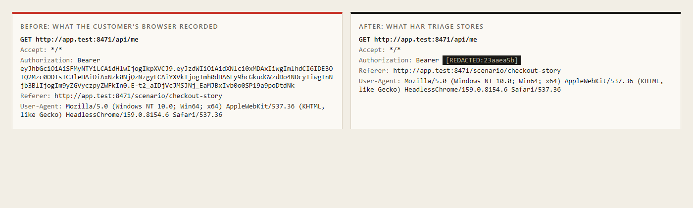
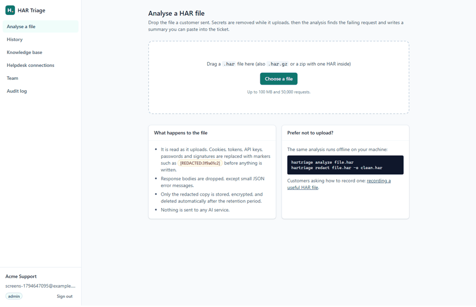
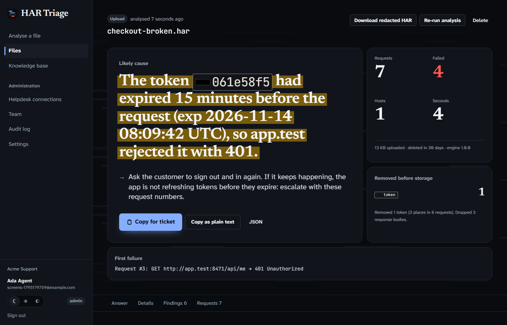
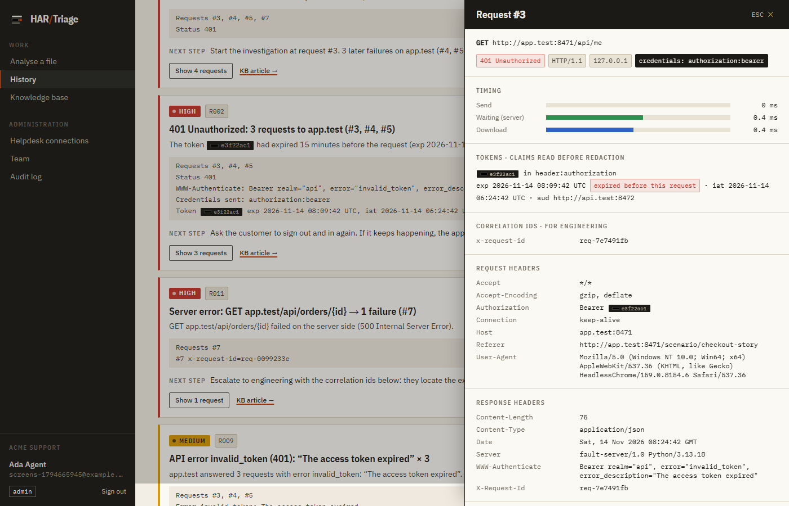
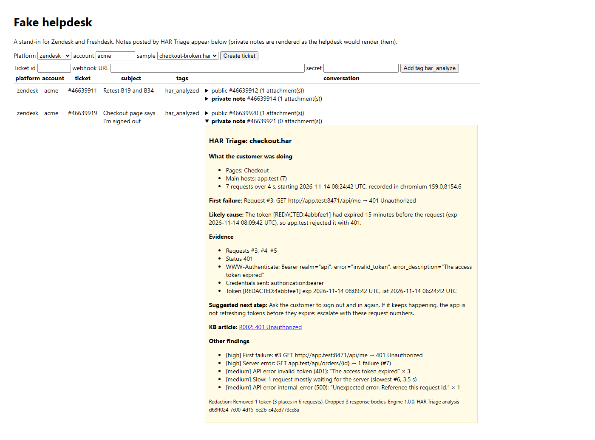
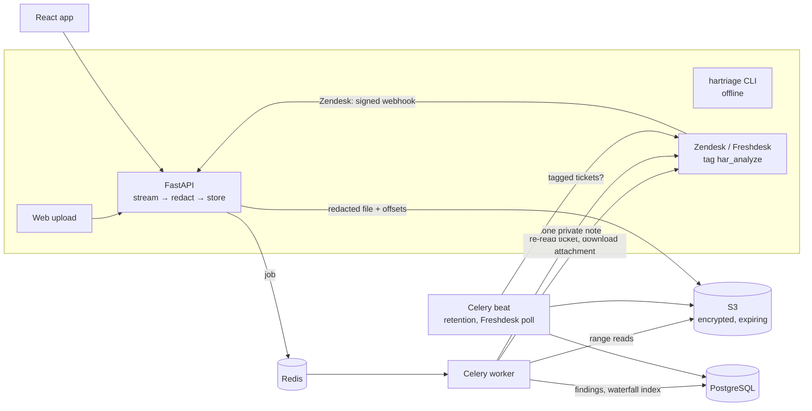

# HAR Triage

Support diagnostics for HAR files: removes session tokens **before anything is stored**, finds the failing request and its likely cause, and writes a summary an agent can paste into the ticket. Use it as a CLI, in the web app, or straight from Zendesk and Freshdesk: tag a ticket and the analysis comes back as a private note.

## Why this exists

When a customer reports "the page is broken", support asks for a HAR file: the browser's record of every request, including its cookies and bearer tokens. In October 2023 an attacker inside Okta's support system took session tokens from customers' HAR files and used them to hijack sessions at five customers.

HAR Triage treats every HAR file as a credential dump: secrets are replaced while the file is read, the original is never written anywhere, and only the redacted copy is kept, encrypted and deleted on a schedule.



## What it looks like



| | |
|---|---|
|  |  |
|  |  |

A ticket summary, exactly as copied:

```markdown
**First failure:** Request #3: GET http://app.test:8471/api/me → 401 Unauthorized

**Likely cause:** The token [REDACTED:451fd7d1] had expired 15 minutes before the request
(exp 2026-11-14 08:09:42 UTC), so app.test rejected it with 401.

**Evidence**
- Requests #3, #4, #5
- WWW-Authenticate: Bearer realm="api", error="invalid_token", error_description="The access token expired"
- Credentials sent: authorization:bearer

**Suggested next step:** Ask the customer to sign out and in again. If it keeps happening,
the app is not refreshing tokens before they expire: escalate with these request numbers.

**KB article:** [R002: 401 Unauthorized](kb/R002-auth.md)
```

## Architecture



- **Streamed, never stored raw.** The upload is parsed with `ijson` one request at a time; each request's facts (credentials present, JWT expiry, correlation ids) are read, then it is redacted and written to a multipart upload. A 54 MB file is processed with a 1 MB memory peak.
- **Rules run on redacted data only**, so no finding, summary or note can contain a secret.
- **The waterfall is an index** in PostgreSQL; opening one request is a byte-range read of the stored file.
- **Exactly one note per analysis**, even when a helpdesk sends the webhook twice or a worker dies after posting.
- **Agents see their own files; admins see all** ([decision 0013](docs/decisions/0013-own-files-only.md)). The Files page lists, filters, downloads and deletes files; deleting purges the redacted copy at once and is audited. Admins set retention (7/30/90 days), a maximum file size, a storage quota and a daily upload limit per member in Settings, and see storage used per member.

Why each of these: [decision records](docs/decisions/).

## The rules

| ID | Finds | |
|---|---|---|
| R001 | **First failure**: the earliest 4xx/5xx or network error, and the failures that followed on the same host | Skips favicon 404s, cancelled requests, ad blockers and sign-in checks |
| R002 | **401/403**: were credentials sent, had the JWT expired (or is the clock wrong), what `WWW-Authenticate` said | Reads `exp`/`iat`/`nbf` before redaction |
| R003 | **CORS** (likely): failed preflights, missing or wrong `Access-Control-Allow-Origin`, `*` with cookies | |
| R004 | **Redirect loops** and long chains; sign-in loops where the session cookie never comes back | |
| R005 | **DNS, connection and TLS failures** from the browser's error code, Chrome and Firefox | Expired certificate, wrong host, untrusted issuer told apart |
| R006 | **Slow requests** and the phase the time went into: queued, DNS, connect, TLS, server wait, download | |
| R007 | **429s**: `Retry-After`, `X-RateLimit-*`, and retries sent before the wait was over | |
| R008 | **413, 414, 431** and very large uploads; cookie size for 431 | |
| R009 | **API error bodies** grouped by code and message (Stripe, OAuth, JSON:API, GraphQL, RFC 9457, FastAPI shapes) | |
| R010 | **Mixed content**: `http://` resources on an `https://` page | |
| R011 | **5xx by endpoint** (`/orders/{id}`), with the correlation ids engineering needs | |

Each rule has a [KB article](kb/) written for the agent working the ticket.

## Redaction

Header, cookie, query, form and JSON values with sensitive names; JWTs, bearer and basic credentials, AWS keys, private keys and common API-key formats anywhere in text; response bodies dropped except small JSON error messages. Every secret becomes `[REDACTED:<8 hex>]`, an HMAC with a salt that exists only while one file is processed: the same token gets the same marker within a file, and markers can't be matched across files.

What is removed, what is kept and why: [docs/redaction-policy.md](docs/redaction-policy.md).

## Quick start

Requirements: Docker.

```bash
docker compose up --build
```

| | |
|---|---|
| Web app | http://localhost:8280 (create an organisation, then drop a HAR file) |
| API | http://localhost:8200, interactive docs at `/docs` ([OpenAPI](docs/openapi.json)) |
| Fake helpdesk | http://localhost:8290 (a Zendesk/Freshdesk stand-in for trying the ticket flow) |
| Object storage | http://localhost:9200 (RustFS, S3-compatible) |

Sample files: [tools/fixtures/samples](tools/fixtures/samples/).

### CLI

```bash
uv sync
uv run hartriage analyze tools/fixtures/samples/checkout-broken.har                # Markdown summary
uv run hartriage analyze file.har --format json --redacted-out clean.har          # JSON + redacted copy
uv run hartriage analyze file.har --fail-on high                                  # exit 1 if anything high-severity
uv run hartriage redact file.har -o clean.har                                     # redact only
uv run hartriage rules
```

Nothing leaves the machine.

### Connecting a helpdesk

Admins add Zendesk (a confidential OAuth client, or agent email + API token on older accounts) or Freshdesk (API key) under **Helpdesk connections**. For Zendesk, the page shows the webhook URL and trigger setup; the webhook's signing secret is added once the webhook exists. Freshdesk needs no setup: its automations cannot fire on a tag change, so HAR Triage polls for tagged tickets every minute ([why](docs/decisions/0011-poll-freshdesk-for-tagged-tickets.md)).

Agents then tag a ticket that has a `.har` attachment with `har_analyze`. A private note arrives for each HAR file on the ticket (never twice for the same file, [why one per file](docs/decisions/0010-one-note-per-har-file.md)), and the tag becomes `har_analyzed`. An admin can also have the original attachment replaced with the redacted copy.

Both helpdesks were tested end to end against real trial accounts: see [live helpdesk testing](docs/live-helpdesk-testing.md) for the scenarios, ticket ids and the seven bugs it found.

## Tests

```bash
docker compose up -d postgres redis s3
uv run pytest                     # unit, property, golden, integration, helpdesk, recorded traffic
uv run ruff check . && uv run mypy
cd frontend && npm test && npm run e2e
```

- **The headline test** ([property test](tests/property/test_redaction_never_leaks.py)): Hypothesis builds HAR files with random secrets planted in 25 kinds of places, from headers and nested JSON to WebSocket messages and URL user-info, and checks that none appears in the redacted file, the findings, the summary or the waterfall, raw, URL-encoded or JSON-escaped. CI runs 3,000 generated files on every push.
- **Golden files**: HARs recorded with Playwright in Chromium *and* Firefox against a [fault server](tools/fixtures/fault_server.py) (401, 403, 413, 429, 431, 5xx, slow, broken CORS, redirect loops, mixed content) and `expired.badssl.com`; each must produce exactly the expected findings.
- **Memory ceiling**: a generated 54 MB HAR is processed under a fixed memory limit (measured peak: about 1 MB).
- **Integration**: the API and tasks against real PostgreSQL and Redis: upload to findings, the raw upload never reaching storage, tenancy (another organisation gets 404, and so does another agent's file), roles, deletes and upload limits, retention really deleting from the database and storage.
- **Helpdesk**: Zendesk signatures (valid, tampered, stale), duplicate webhooks giving one note, a 429 retried, a crash after posting not posting twice, attachment replacement, credentials never sent to a download host, Freshdesk polling, the Zendesk OAuth client renewing its token. The [fake helpdesk](tools/fake_helpdesk/app.py) copies every real-API quirk found in live testing.
- **Recorded traffic** ([cassettes](tests/cassettes)): the real Zendesk and Freshdesk clients replayed against traffic recorded from live trial accounts, scrubbed of credentials, tokens, signed links, emails and subdomains ([how](docs/live-helpdesk-testing.md#recorded-traffic-in-ci)).
- **Frontend**: Vitest for the API client, helpers and pages; Playwright for upload → findings → copy for ticket → request detail, and for agents seeing and deleting only their own files while the admin sees everyone's.

CI ([workflow](.github/workflows/ci.yml)) also runs gitleaks over the whole history and builds both images.

## Casebook

[Eight support cases](casebook/) against Relay (Project 1), each reproducible with one script: an expired certificate, clock drift breaking signatures, a retry flood after an outage, an SSRF-blocked endpoint, a 413 whose HAR carried a live API key, a secret rotation that was never deployed, a lock that emptied the connection pool, and a duplicate webhook after a worker crash. Each has the evidence, root cause, fix, verification and the reply to the customer.

## Project layout

```
hartriage/
  har/        stream_reader (ijson), redactor, metadata, model, writer
  rules/      R001–R011, one small class each
  summary/    ticket summary → Markdown, text, JSON, HTML
  api/        auth, members, uploads, analyses, connections, webhooks, health, KB, audit
  services/   intake (stream → redact → store), analysis, retention, audit
  helpdesk/   Zendesk and Freshdesk clients, exactly-once note task
  worker/     Celery app and tasks
  storage/    S3 multipart writer and range reads; in-memory store for tests
  cli/        hartriage analyze | redact | rules
frontend/     React, TypeScript, TanStack Query and Virtual, Tailwind
kb/           one article per rule
casebook/     eight reproducible support cases against Relay
tools/        fault server and HAR recorder, fake helpdesk, screenshot script,
              live/ scripts for testing against real helpdesk trials
docs/         decision records, redaction policy, OpenAPI, screenshots
```

## What I'd do next

- Zendesk's authorization-code OAuth flow (a "Connect with Zendesk" button) alongside the confidential client.
- Plain-text log files: the redactor already handles free text, but there are no log rules yet.
- A public demo mode that analyses sample files in memory and stores nothing.
- Per-organisation retention and a customer-facing "send us a HAR" upload link that redacts in the browser before upload.

## Licence

[MIT](LICENSE)
